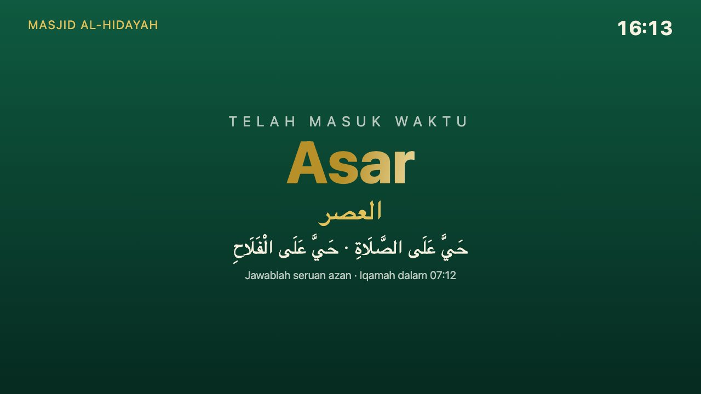
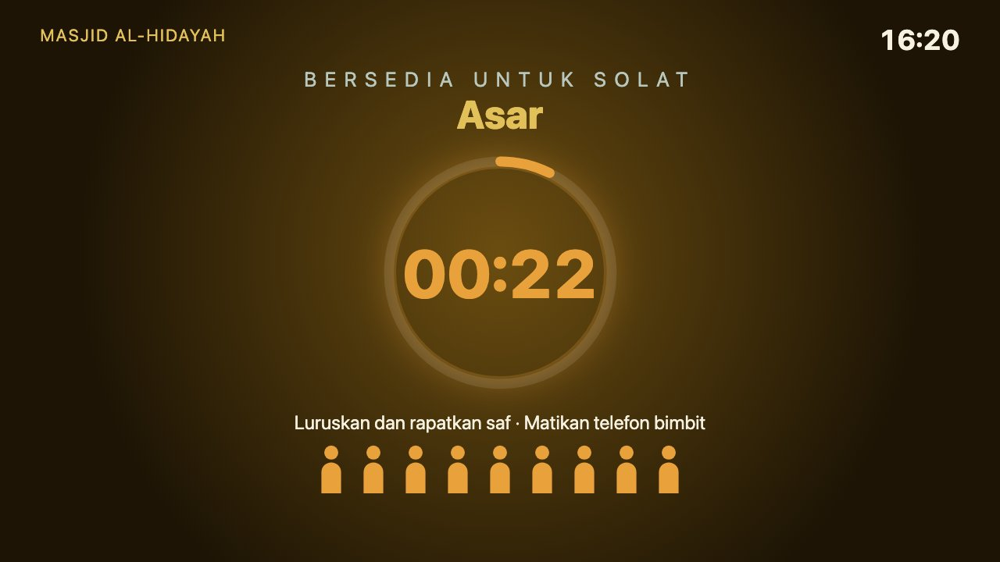
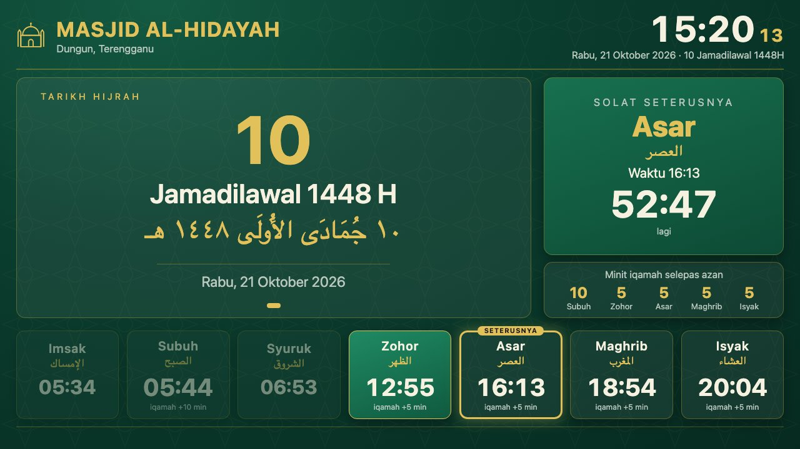
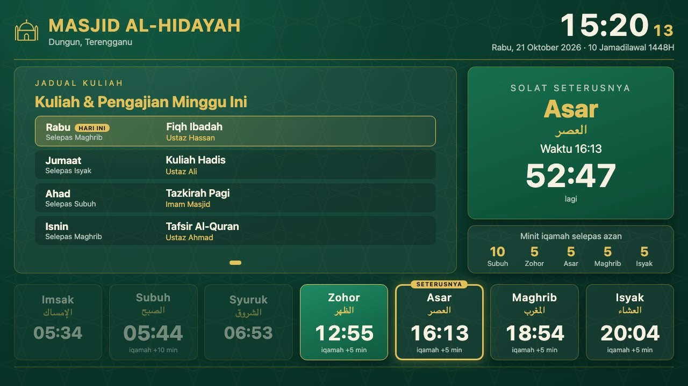
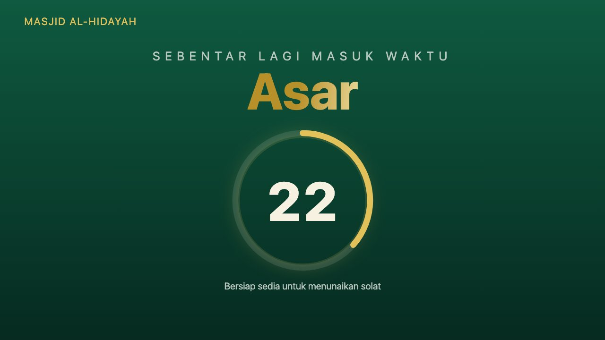
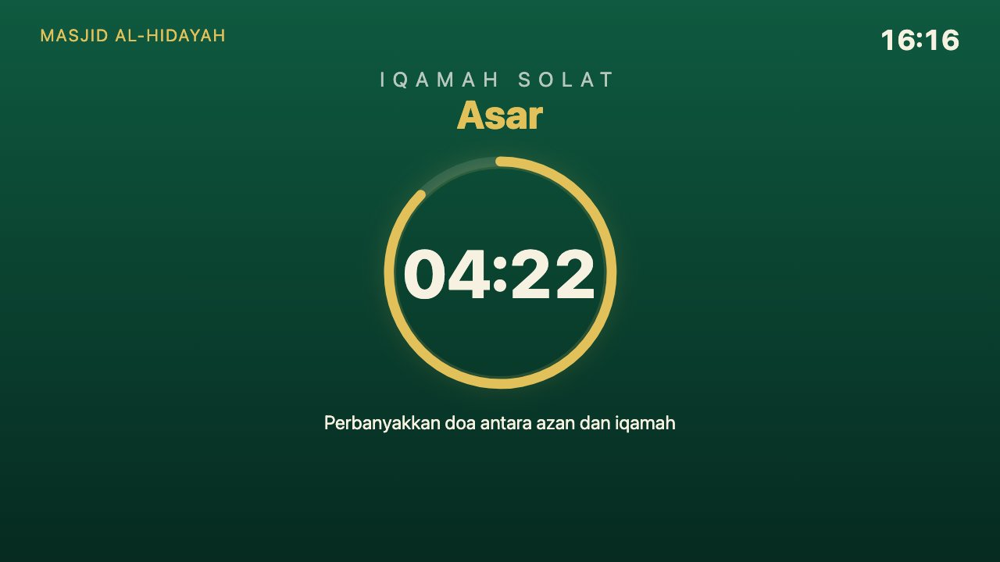
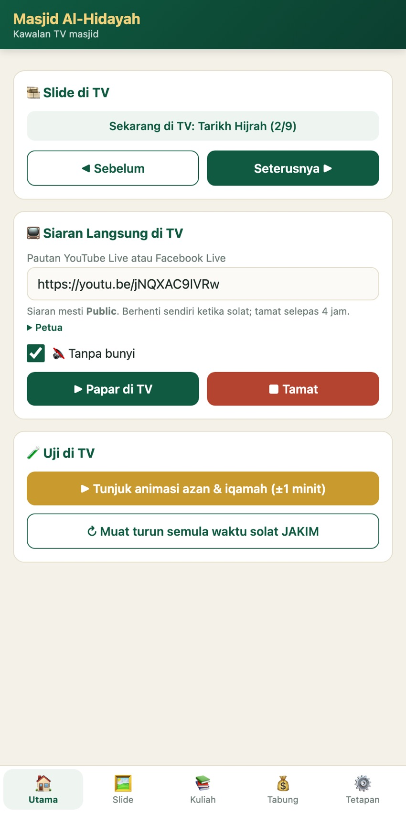

# Masjid TV — Paparan Masjid (Android TV)

Dicipta oleh **Pokka99**. Lesen [Apache 2.0](LICENSE): bebas diguna dan diubah suai, tetapi fail [NOTICE](NOTICE) (kredit pencipta) mesti dikekalkan dalam setiap salinan dan fork.

<p align="center">
  
  
  
</p>

**[⬇ Muat turun APK terkini](https://github.com/Pokka99/Masjid-TV/releases/latest)**

Skrin paparan masjid untuk TV Android, satu fail `app/src/main/assets/index.html` dibungkus dalam WebView.

## Pratonton

| | |
|---|---|
|  |  |
| *Slide gambar masjid, bergilir 13 gambar* | *Skrin utama dengan tarikh Hijrah* |
|  |  |
| *Jadual kuliah, kuliah hari ini ditanda* | *Kutipan tabung mingguan* |
|  |  |
| *Poster kuliah dari telefon atau pendrive* | *Ayat Al-Quran dengan terjemahan* |
|  |  |
| *60 saat sebelum masuk waktu* | *Skrin azan bila masuk waktu* |
|  |  |
| *Kiraan iqamah* | *Minit terakhir: luruskan dan rapatkan saf* |
|  |  |
| *Solat sedang berlangsung* | *Tetapan di TV, dengan QR untuk telefon* |

<p align="center"><br><em>Kawalan dari telefon</em></p>

## Fungsi
- **Waktu solat JAKIM** (e-Solat, ikut kod zon) — dimuat turun setahun sekali, simpan dalam TV, tetap jalan jika internet putus.
- **Kiraan detik solat seterusnya**; kotak bertukar emas & berdenyut bila tinggal ≤ 5 minit sebelum masuk waktu.
- **Animasi waktu solat** (skrin penuh):
  1. 60 saat terakhir sebelum masuk waktu — cincin kiraan detik.
  2. Masuk waktu — skrin azan (bintang berputar, gelang cahaya, nama waktu emas) selama 3 minit (boleh ubah).
  3. Iqamah — cincin kiraan detik 5 minit (boleh ubah setiap waktu); minit terakhir jadi jingga + animasi saf "Luruskan dan rapatkan saf".
  4. "Solat sedang berlangsung" (gelap, minta matikan telefon). Hari Jumaat: skrin khutbah.
- **Slide gambar masjid** skrin penuh: jam besar, tarikh Masihi/Hijrah, 5 waktu, kiraan ke solat seterusnya, ayat; 13 gambar masjid (Wikimedia Commons, kredit dipapar) bergilir.
- **Slide automatik**: Tarikh Hijrah (Rumi + Jawi), Jadual Kuliah (hari ini ditanda), Kutipan Tabung mingguan (+ perbandingan minggu lepas), Ayat Al-Quran (10 ayat, teks Arab + terjemahan Kemenag RI).
- **Poster kuliah**: gambar dalam folder bernama `Poster` dipapar sebagai slide (2 kali setiap pusingan, bergilir).
- **Slide pengumuman** sendiri (tajuk + teks), ditambah dari telefon.
- **Siaran langsung di TV**: tampal pautan YouTube Live atau Facebook Live di telefon → TV papar skrin penuh. Berhenti sendiri ketika azan, iqamah dan solat, kemudian sambung semula; tamat sendiri selepas 4 jam.
- Teks bergerak untuk pengumuman. Hidup sendiri bila TV dibuka; skrin tidak tidur.

## Kawal dari telefon
Tekan **MENU** pada remote → imbas **kod QR** di penjuru kanan atas dengan kamera telefon (telefon mesti guna Wi-Fi yang sama dengan TV).
Halaman telefon boleh: tukar slide di TV (◀ ▶, dengan nama slide semasa), papar siaran langsung, tambah slide pengumuman, ubah kutipan tabung (ada butang "Minggu baharu"), muat naik / padam poster dari galeri, edit jadual kuliah,
pengumuman, nama masjid, zon, minit iqamah, dan **uji animasi azan & iqamah** di TV.
Dilindungi PIN 6 digit (dipapar di TV); 10 cubaan salah = dikunci 5 minit.

## Tetapan (guna remote)
Tekan **MENU** (atau **OK 3 kali** dengan cepat). ▲▼ untuk bergerak, OK untuk menaip, BACK untuk tutup.
Boleh ubah: nama masjid, zon JAKIM, minit iqamah, tempoh solat, kutipan tabung, jadual kuliah, teks bergerak.

## Tambah poster kuliah
Saiz poster terbaik:

| Bentuk | Saiz | Cara dipapar | Di Canva |
|---|---|---|---|
| Potret | **1080 × 1350** (4:5) | Dalam kotak slide, waktu solat kekal kelihatan | "Instagram Post (4:5)" |
| Landskap | **1920 × 1080** (16:9) | **Skrin penuh**, dengan cip jam dan solat seterusnya di penjuru | "Presentation (16:9)" |

Saiz lain juga boleh — poster dimuatkan tanpa dipotong, dan ruang kosong diisi latar kabur daripada poster itu sendiri.

Simpan gambar (JPG/PNG) dalam folder bernama **`Poster`**. Ada 3 cara:
1. **Pendrive** — buat folder `Poster` dalam pendrive, masukkan poster, cucuk ke TV. Cabut pendrive = poster hilang dari slide.
2. **Dari komputer (Wi-Fi)** — `./poster.sh <IP-TV> poster1.jpg poster2.jpg`; `--senarai` untuk lihat, `--padam-semua` untuk buang.
3. **Pautan internet** — dalam Tetapan, isi "Pautan poster" (satu URL gambar setiap baris).

Poster baharu muncul dalam pusingan slide seterusnya. Kali pertama app dibuka, benarkan akses gambar bila TV bertanya.

## Siaran langsung di TV
- Pautan yang diterima: `youtube.com/watch?v=…`, `youtu.be/…`, `youtube.com/live/…`, `youtube.com/channel/UC…/live` (sentiasa siaran terkini saluran itu), pautan video Facebook, atau terus `.m3u8`/`.mp4`.
- Siaran mesti **Public**. YouTube lebih stabil daripada Facebook.
- Live internet lewat 10–30 saat: jika TV dalam masjid yang sama dengan penceramah, matikan bunyi TV supaya tidak bergema.

## Pasang
```
./install.sh <IP-TV>
```
Atau salin `dist/PaparanMasjid.apk` ke pendrive dan pasang guna file manager di TV.

## Bina semula
```
export JAVA_HOME=~/glass-tv-sdk/jdk-17.0.20.1+1/Contents/Home ANDROID_HOME=~/glass-tv-sdk/sdk
./gradlew assembleRelease && cp app/build/outputs/apk/release/app-release.apk dist/PaparanMasjid.apk
```
Uji di browser: buka `index.html?now=2026-10-22T16:12:00` untuk lompat ke masa tertentu, atau `index.html?demo=1` untuk demo animasi (±1 minit), atau `index.html?slide=kuliah` untuk kekal pada satu slide (`scene`, `date`, `kuliah`, `poster`, `tabung`, `ayat`).

## Kredit
- Waktu solat & tarikh Hijrah: [JAKIM e-Solat](https://www.e-solat.gov.my).
- Teks ayat: quran.com (edisi Imla'ei); terjemahan: *Al-Qur'an dan Terjemahannya*, Kemenag RI — diambil melalui quran.ai.
- Fon ayat: [Amiri Quran](https://github.com/aliftype/amiri) (SIL OFL 1.1, lihat `app/src/main/assets/fonts/AMIRI-LICENSE-OFL.txt`).
- Gambar masjid: Wikimedia Commons; jurugambar dan lesen setiap gambar dalam `app/src/main/assets/masjid/captions.json` dan dipapar di skrin.
- Kod QR: [qrcode-generator](https://github.com/kazuhikoarase/qrcode-generator) oleh Kazuhiko Arase (MIT).
